<!-- Dibuat otomatis oleh scripts/generate.mjs. Jangan edit tangan; ubah profile.config.json atau scripts. -->

<a href="https://www.pawang.dev"></a> 
 
<a href="https://www.pawang.dev">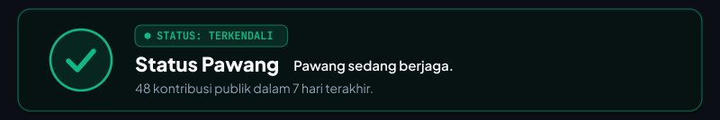</a> 
<a href="https://www.pawang.dev">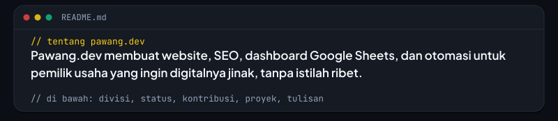</a> 
<a href="https://www.pawang.dev">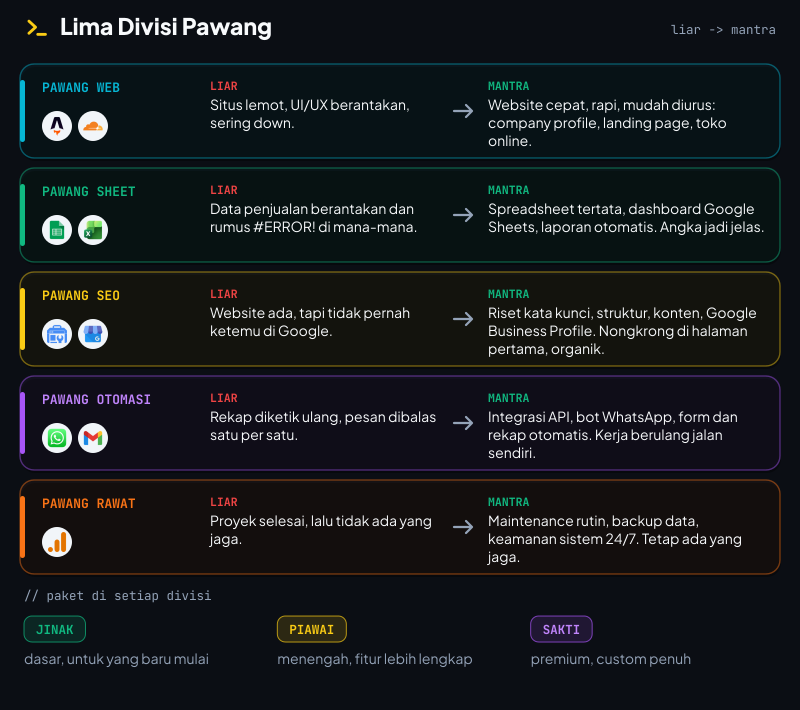</a> 
<a href="https://www.pawang.dev">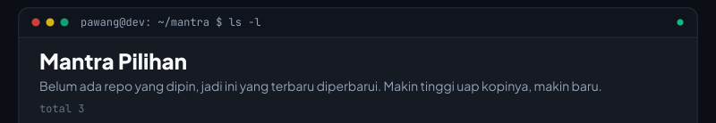</a> 
<a href="https://github.com/pawang-dev/pawang-dev"></a> 
 
 
<a href="https://www.pawang.dev">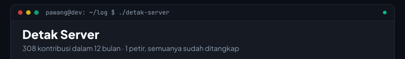</a> 
<a href="https://www.pawang.dev"><picture><source media="(prefers-reduced-motion: reduce)" srcset="https://raw.githubusercontent.com/pawang-dev/pawang-dev/assets/trace-3d-still.png">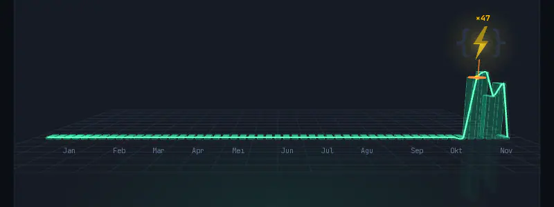</picture></a> 
<a href="https://www.pawang.dev">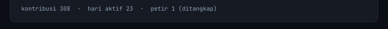</a> 
<a href="https://www.pawang.dev"></a> 
<a href="https://www.pawang.dev">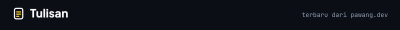</a> 
<a href="https://www.pawang.dev/artikel/panduan-otomasi-usaha-kecil">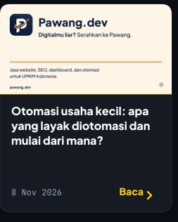</a><a href="https://www.pawang.dev/artikel/pesanan-whatsapp-otomatis-google-sheets">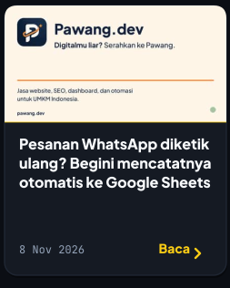</a><a href="https://www.pawang.dev/artikel/merapikan-data-penjualan-jadi-dashboard-google-sheets">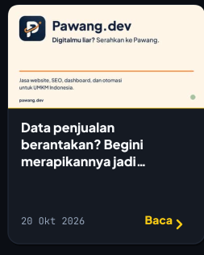</a> 
<a href="https://www.pawang.dev">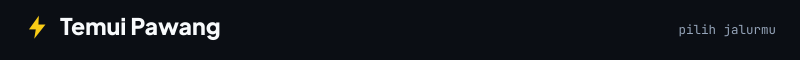</a> 
<a href="https://www.instagram.com/pawang.dev/">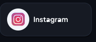</a><a href="https://www.tiktok.com/@pawang.dev?lang=id-ID">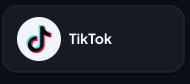</a><a href="https://x.com/pawangdev">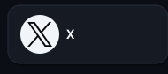</a> 
<a href="https://www.threads.com/@pawang.dev">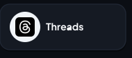</a> 
<a href="https://www.pawang.dev">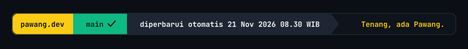</a> 

