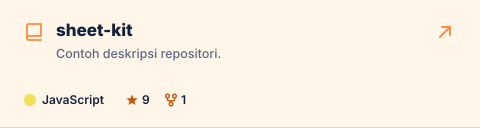
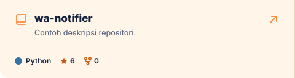
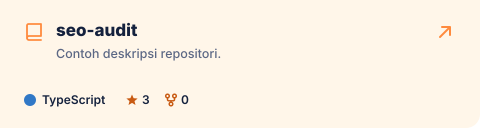

<!-- Dibuat otomatis oleh scripts/build_all.py. Ubah assets/data/profile.json, bukan file ini. -->

<a href="https://www.pawang.dev">
<picture>
  <source media="(prefers-color-scheme: dark)" srcset="assets/svg/cards/neofetch_dark.svg">
  <source media="(prefers-color-scheme: light)" srcset="assets/svg/cards/neofetch_light.svg">
  
</picture>
</a> 

  
<a href="https://github.com/pawang-dev?tab=repositories">
<picture>
  <source media="(prefers-color-scheme: dark)" srcset="assets/svg/featured/header_dark.svg">
  <source media="(prefers-color-scheme: light)" srcset="assets/svg/featured/header_light.svg">
  
</picture>
</a> 
 

  
<picture>
  <source media="(prefers-color-scheme: dark)" srcset="assets/svg/articles/header_dark.svg">
  <source media="(prefers-color-scheme: light)" srcset="assets/svg/articles/header_light.svg">
  
</picture> 
 
 

  
<a href="https://github.com/pawang-dev">
<picture>
  <source media="(prefers-color-scheme: dark)" srcset="assets/svg/activity/header_dark.svg">
  <source media="(prefers-color-scheme: light)" srcset="assets/svg/activity/header_light.svg">
  
</picture>
</a> 
 
 
 
 

